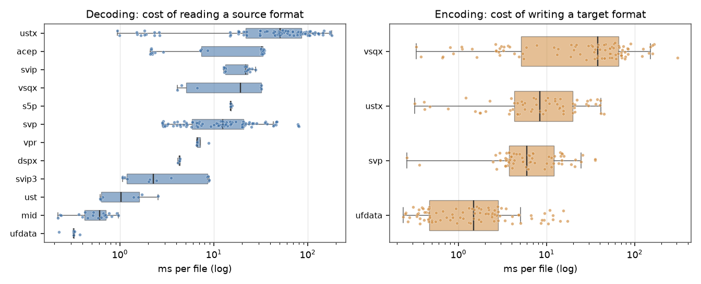
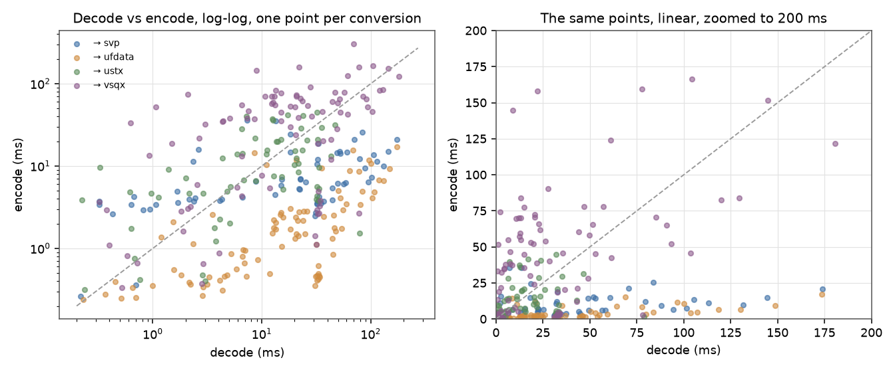
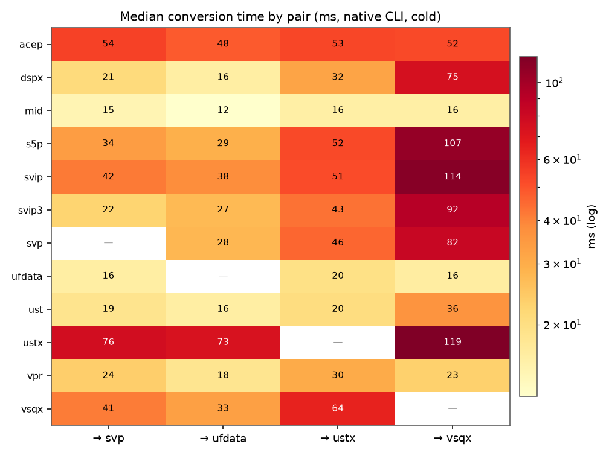
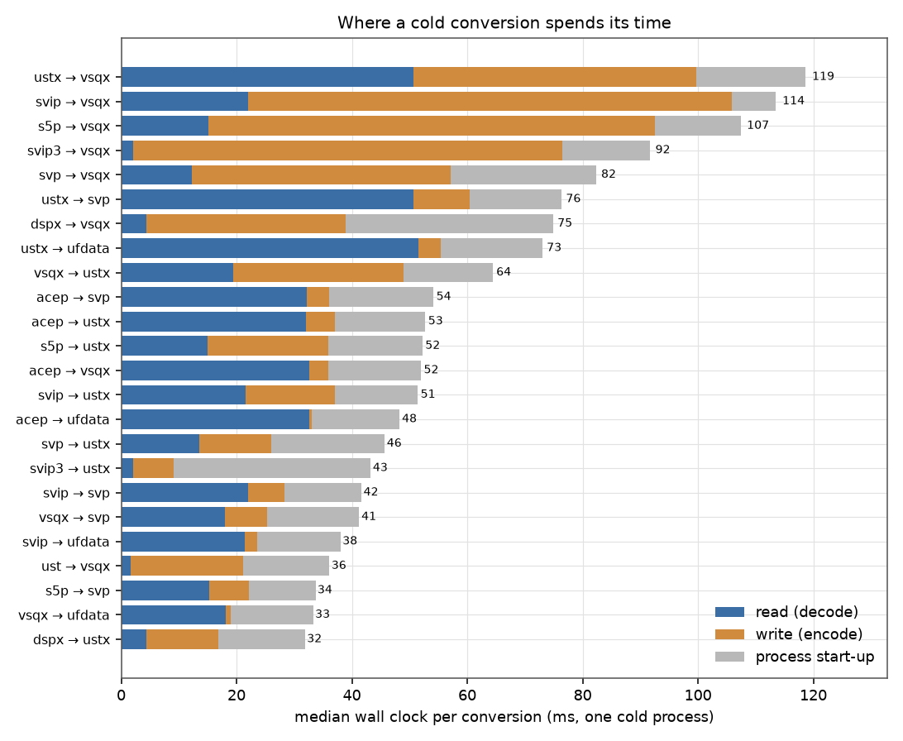
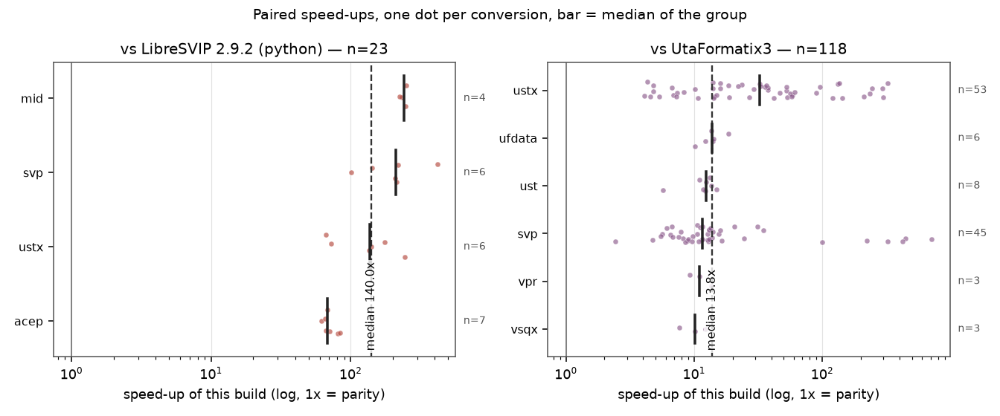
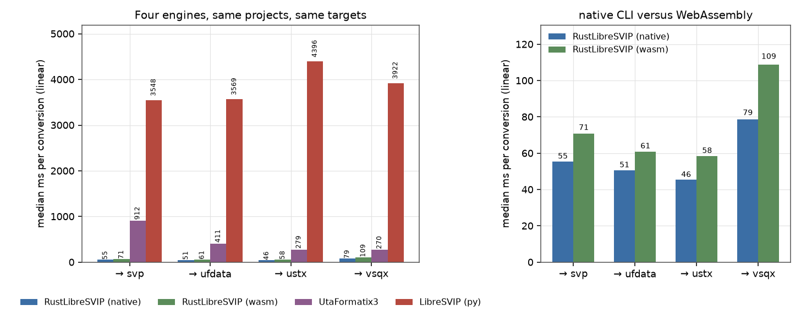
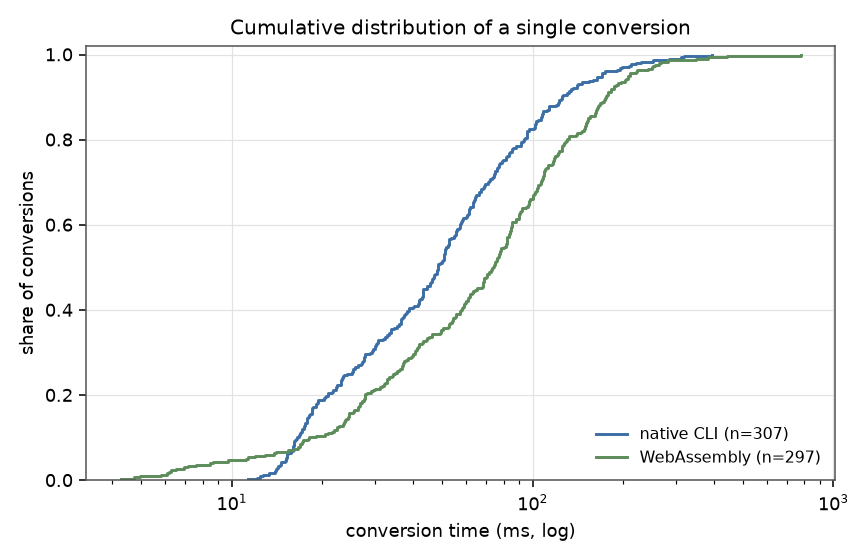
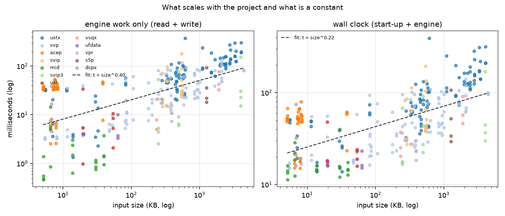
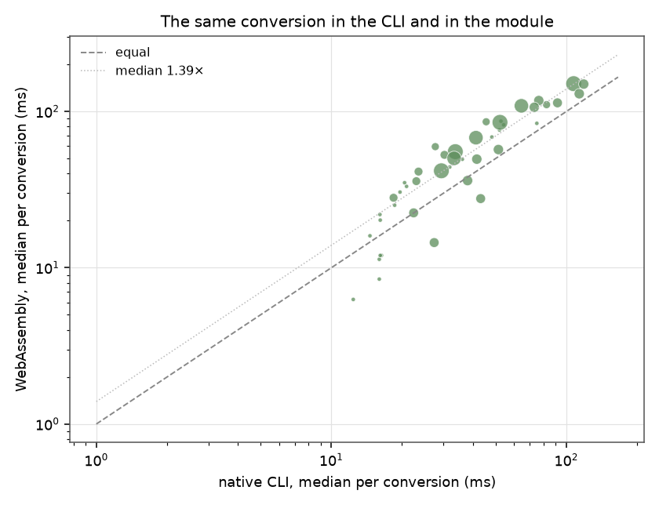
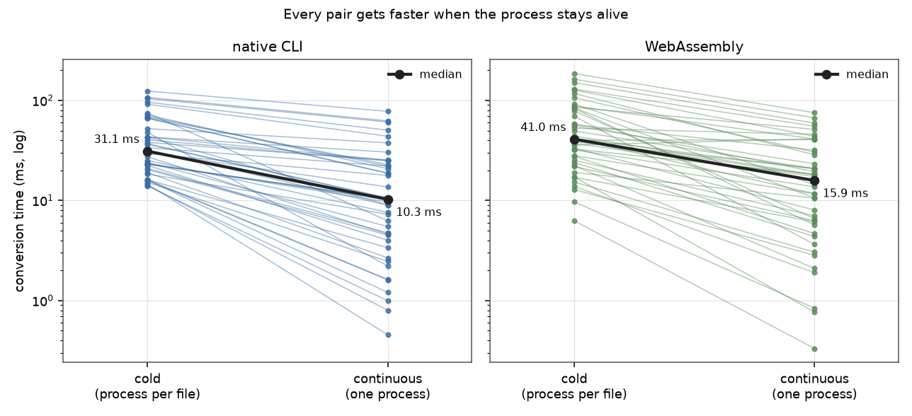

# Benchmark on real projects

Speed and data-fidelity measurements for RustLibreSVIP against the two things it
is built from — the Python LibreSVIP 2.9.2 reference and UtaFormatix3 — plus the
WebAssembly build that ships in the browser demo. Everything below was measured
on projects that already existed on the developer's disks: no generated
fixtures, no cherry-picked inputs. The per-file rows behind every table are
committed under [`benchmark-data/`](benchmark-data/); the scripts that produce
them are in [`scripts/bench_corpus`](../scripts/bench_corpus).

## Headline

- RustLibreSVIP is a **median 140x faster than the Python reference** on identical
  inputs (n=23 paired conversions, range 61x–416x) and **13.8x faster than
  UtaFormatix3** over 118 paired conversions (range 2.4x–713x).
- **Decoding and encoding are separate costs, and they are measured separately
  here.** Over the 44 pairs, a conversion spends a median 27% of its wall clock
  — 54% of the engine's own time — reading the source format; weighted by
  conversions (the corpus is `.ustx`-heavy) the reader is 38% of the wall clock
  and 77% of the engine time. Either way the reader's cost depends only on the
  source format and the writer's only on the target.
- On the *same* input, this build and the Python reference agree on **99.9% of
  notes exactly** and produce **identical pitch curves** after a round trip
  through SVP (29 projects).
- The **WebAssembly build converts a real project in a median 74 ms**
  (median over the 44 pairs: 49.5 ms) and instantiates in 10.8 ms — a 6.0 MB
  module with zero imports. Per conversion that is **1.39x the CLI's wall
  clock** and 2.63x its engine time.
- **Converting continuously is 3.0x cheaper than starting a process per file.**
  Inside one long-lived process a conversion costs a median **10.3 ms** against
  31.1 ms cold; WebAssembly goes from 41.0 ms for the first conversion in a
  fresh module to **15.9 ms** in the steady state.
- The matrix is 44 source → target pairs over 12 source formats and 4 targets;
  every pair has a row in [the full matrix](#every-pair-every-engine).
- Four real bugs fell out of the comparison, all fixed: two strict-schema
  parsing failures (acep, svip), a VSQX writer that allocated 4–6 GiB and needed
  100–203 s on some SVIP projects, and an SVP writer whose tension, breathiness
  and gender curves were computed as `1000/value` instead of `value/1000`.
  The one remaining failure class is LibreSVIP's own refusal to convert
  overlapping notes, which the port reproduces on purpose.

## How it was measured

| item | value |
| --- | --- |
| corpus | 4,706 project files found on disk; 111 selected cases (72 core, 33 LibreSVIP-only formats, 6 stress) |
| formats | USTX, SVP, VSQX, VSQ, UST, UFData, VPR, S5P, CCS, MusicXML, AI singing (acep/aisp), Synthesizer V (svip/svip3), MIDI, DSPX |
| targets | `ufdata`, `svp`, `ustx`, `vsqx` |
| RustLibreSVIP | `target/release/libresvip-cli.exe`, 1.1.0 + the fixes of this round |
| LibreSVIP (py) | 2.9.2, CPython 3.12 in the `study12` environment, CLI entry point |
| UtaFormatix3 | `f3c8335`, Kotlin/JS library built with Gradle and driven by a Node harness |
| WebAssembly | `cargo build --profile wasm -p libresvip-web --target wasm32-unknown-unknown`, 6,015,525 bytes |
| timing | one conversion per fresh process, wall clock, conversions run strictly one after another |
| machine | Windows 11, single desktop, nothing else running during the runs |

Both timing runs and correctness runs used the same files. A conversion is only
compared when both engines could read the input. The Python reference is only
timed on the subset it can finish (23 conversions, 5 KB – 500 KB), and
UtaFormatix3 is capped (1.2 MB inputs, 200 KB for its XML exporters, 120 s) —
those caps are reported rather than silently averaged in.

### The two halves of a conversion

Every conversion is one **read** of the source format into the internal project
and one **write** of that project into the target format. Both halves are timed
separately by `phases.exe`, an example binary in the CLI crate (not part of the
shipped CLI) that loads and dumps inside one process and prints
`{"load_ms":…,"dump_ms":…}`.

This is the reason the tables below are organised by *role* rather than by
format: a table of "time per source format" that mixes decode and encode is
unreadable, because the same source file costs 54 ms when written to VSQX and
16 ms when written to UFData. Decoding gets its own table, encoding gets its
own, and the 44 pairs get a matrix.

Input files are read once before the clock starts — part of the corpus lives on
a cloud-sync virtual drive, where a cold read of a 493 KB project took 235 ms
against 3.5 ms warm.

## Decoding and encoding are different problems

### Decoding by source format

Median over every conversion of that source; `MB/s` divides the input size by
the decode time. Files are different sizes, so the `median input` column is part
of the result, not decoration.

| source | conversions | median input | decode median | p25 | p75 | MB/s |
|---|---|---|---|---|---|---|
| `ustx` | 96 | 533 KB | 50.9 ms | 22.0 ms | 88.0 ms | 10.2 |
| `acep` | 40 | 7 KB | 32.3 ms | 7.3 ms | 33.2 ms | 0.2 |
| `svip` | 20 | 541 KB | 21.8 ms | 13.3 ms | 23.6 ms | 24.3 |
| `vsqx` | 6 | 1065 KB | 19.2 ms | 4.6 ms | 32.0 ms | 54.1 |
| `s5p` | 4 | 1265 KB | 15.2 ms | 15.1 ms | 15.7 ms | 81.5 |
| `svp` | 87 | 324 KB | 12.4 ms | 5.8 ms | 20.8 ms | 25.4 |
| `vpr` | 4 | 390 KB | 6.6 ms | 6.6 ms | 8.8 ms | 57.5 |
| `dspx` | 4 | 7 KB | 4.3 ms | 4.3 ms | 4.4 ms | 1.5 |
| `svip3` | 12 | 493 KB | 2.3 ms | 1.2 ms | 8.7 ms | 213.0 |
| `ust` | 8 | 37 KB | 1.0 ms | 0.6 ms | 1.7 ms | 35.0 |
| `mid` | 20 | 14 KB | 0.6 ms | 0.4 ms | 0.7 ms | 22.1 |
| `ufdata` | 6 | 42 KB | 0.3 ms | 0.3 ms | 0.3 ms | 126.3 |



The two orders of magnitude between `ufdata` (0.3 ms) and `ustx` (51 ms) are
mostly format shape, not engine quality: UFData is a flat JSON array of ticks,
USTX is a JSON project with per-note pitch curves that have to be merged into
one curve. `.acep` is the outlier in the other direction — 7 KB files that cost
32 ms because the container is a zip whose JSON holds a full parameter stack.

### Encoding by target format

| target | conversions | median output | encode median | p25 | p75 | MB/s |
|---|---|---|---|---|---|---|
| `vsqx` | 91 | 1148 KB | 38.3 ms | 4.9 ms | 66.2 ms | 29.3 |
| `ustx` | 61 | 377 KB | 8.4 ms | 4.3 ms | 19.7 ms | 44.0 |
| `svp` | 64 | 159 KB | 5.9 ms | 3.8 ms | 12.3 ms | 26.2 |
| `ufdata` | 91 | 316 KB | 1.5 ms | 0.5 ms | 2.8 ms | 206.7 |

The writer is the smaller half of most conversions, with one exception: VSQX
costs 38 ms against UFData's 1.5 ms for the same project, because it renders
every pitch bend into XML.

### They do not predict each other



If decode and encode were two views of one cost, the points would sit on a line.
They form a cloud: a 100 ms decode can pair with a 5 ms or a 100 ms encode. The
colour separates targets — the vertical bands are the four writers, the
horizontal spread inside a band is the reader.

## The pair matrix



The matrix makes the additive structure visible: a row's height is set by its
reader, a column's colour by its writer. `ustx → vsqx` is the slowest cell
(119 ms), `mid → ufdata` the fastest (12 ms), and the cells that do not exist in
the corpus are marked with a dash.

### Every pair, every engine

One row per measured pair; every column is a median over that pair's
conversions:

| column | what it measures |
|---|---|
| `py` | the Python LibreSVIP 2.9.2 CLI, wall clock ("—" when Python never ran that pair) |
| `libresvip / rust` | this project's native CLI, wall clock: process start-up + read + write |
| `uf3` | UtaFormatix3 through the Node harness, wall clock ("—" when uf3 never ran it) |
| `wasm` | this project's WebAssembly build, the in-module conversion only |
| `read` / `write` | the two halves of the native conversion |

| source → target | pairs | input | py (LibreSVIP 2.9.2) | libresvip / rust (native CLI) | uf3 (UtaFormatix3) | wasm (in-module) | read | write |
|---|---|---|---|---|---|---|---|---|
| `acep` → `svp` | 10 | 7 KB | 3754 ms | 54 ms | — | 82 ms | 32.2 ms | 3.9 ms |
| `acep` → `ufdata` | 10 | 7 KB | 3314 ms | 48 ms | — | 69 ms | 32.6 ms | 0.5 ms |
| `acep` → `ustx` | 10 | 7 KB | 4939 ms | 53 ms | — | 87 ms | 32.0 ms | 5.0 ms |
| `acep` → `vsqx` | 10 | 7 KB | 4384 ms | 52 ms | — | 76 ms | 32.6 ms | 3.3 ms |
| `dspx` → `svp` | 1 | 7 KB | — | 21 ms | — | 33 ms | 4.3 ms | 4.0 ms |
| `dspx` → `ufdata` | 1 | 7 KB | — | 16 ms | — | 22 ms | 4.1 ms | 0.4 ms |
| `dspx` → `ustx` | 1 | 7 KB | — | 32 ms | — | 44 ms | 4.4 ms | 12.4 ms |
| `dspx` → `vsqx` | 1 | 7 KB | — | 75 ms | — | 84 ms | 4.3 ms | 34.6 ms |
| `mid` → `svp` | 5 | 14 KB | 3548 ms | 15 ms | — | 16 ms | 0.7 ms | 2.6 ms |
| `mid` → `ufdata` | 5 | 14 KB | 3406 ms | 12 ms | — | 6 ms | 0.5 ms | 0.3 ms |
| `mid` → `ustx` | 5 | 14 KB | 3571 ms | 16 ms | — | 11 ms | 0.7 ms | 0.8 ms |
| `mid` → `vsqx` | 5 | 14 KB | 3460 ms | 16 ms | — | 8 ms | 0.6 ms | 0.8 ms |
| `s5p` → `svp` | 1 | 1265 KB | — | 34 ms | — | 55 ms | 15.2 ms | 6.9 ms |
| `s5p` → `ufdata` | 1 | 1265 KB | — | 29 ms | — | 42 ms | 15.7 ms | 2.4 ms |
| `s5p` → `ustx` | 1 | 1265 KB | — | 52 ms | — | 85 ms | 15.0 ms | 20.9 ms |
| `s5p` → `vsqx` | 1 | 1265 KB | — | 107 ms | — | 151 ms | 15.1 ms | 77.4 ms |
| `svip` → `svp` | 5 | 541 KB | — | 42 ms | — | 50 ms | 22.0 ms | 6.4 ms |
| `svip` → `ufdata` | 5 | 541 KB | — | 38 ms | — | 36 ms | 21.4 ms | 2.2 ms |
| `svip` → `ustx` | 5 | 541 KB | — | 51 ms | — | 57 ms | 21.5 ms | 15.6 ms |
| `svip` → `vsqx` | 5 | 541 KB | — | 114 ms | — | 130 ms | 22.1 ms | 83.8 ms |
| `svip3` → `svp` | 3 | 493 KB | — | 22 ms | — | 22 ms | 2.4 ms | 4.1 ms |
| `svip3` → `ufdata` | 3 | 493 KB | — | 27 ms | — | 14 ms | 3.5 ms | 2.6 ms |
| `svip3` → `ustx` | 3 | 493 KB | — | 43 ms | — | 28 ms | 2.0 ms | 7.1 ms |
| `svip3` → `vsqx` | 3 | 493 KB | — | 92 ms | — | 114 ms | 2.1 ms | 74.4 ms |
| `svp` → `ufdata` | 29 | 324 KB | 3756 ms | 28 ms | 272 ms | 60 ms | 12.6 ms | 1.3 ms |
| `svp` → `ustx` | 29 | 324 KB | 11484 ms | 46 ms | 289 ms | 86 ms | 13.5 ms | 12.5 ms |
| `svp` → `vsqx` | 29 | 324 KB | 6762 ms | 82 ms | 229 ms | 111 ms | 12.3 ms | 44.8 ms |
| `ufdata` → `svp` | 2 | 42 KB | — | 16 ms | 208 ms | 20 ms | 0.3 ms | 3.6 ms |
| `ufdata` → `ustx` | 2 | 42 KB | — | 20 ms | 232 ms | 30 ms | 0.3 ms | 6.8 ms |
| `ufdata` → `vsqx` | 2 | 42 KB | — | 16 ms | 264 ms | 12 ms | 0.3 ms | 3.3 ms |
| `ust` → `svp` | 2 | 37 KB | — | 19 ms | 226 ms | 25 ms | 1.2 ms | 3.5 ms |
| `ust` → `ufdata` | 2 | 37 KB | — | 16 ms | 219 ms | 12 ms | 1.1 ms | 0.4 ms |
| `ust` → `ustx` | 2 | 37 KB | — | 20 ms | 246 ms | 35 ms | 1.0 ms | 7.0 ms |
| `ust` → `vsqx` | 2 | 37 KB | — | 36 ms | 301 ms | 49 ms | 1.6 ms | 19.6 ms |
| `ustx` → `svp` | 32 | 533 KB | 7504 ms | 76 ms | 2293 ms | 118 ms | 50.7 ms | 9.8 ms |
| `ustx` → `ufdata` | 32 | 533 KB | 11253 ms | 73 ms | 2230 ms | 106 ms | 51.6 ms | 3.8 ms |
| `ustx` → `vsqx` | 32 | 533 KB | 13248 ms | 119 ms | 327 ms | 150 ms | 50.7 ms | 49.1 ms |
| `vpr` → `svp` | 1 | 390 KB | — | 24 ms | 259 ms | 41 ms | 6.6 ms | 4.2 ms |
| `vpr` → `ufdata` | 1 | 390 KB | — | 18 ms | 250 ms | 28 ms | 6.6 ms | 0.8 ms |
| `vpr` → `ustx` | 1 | 390 KB | — | 30 ms | 281 ms | 53 ms | 8.8 ms | 6.7 ms |
| `vpr` → `vsqx` | 1 | 390 KB | — | 23 ms | — | 36 ms | 6.6 ms | 4.3 ms |
| `vsqx` → `svp` | 2 | 1065 KB | — | 41 ms | 256 ms | 68 ms | 18.0 ms | 7.2 ms |
| `vsqx` → `ufdata` | 2 | 1065 KB | — | 33 ms | 249 ms | 50 ms | 18.2 ms | 0.8 ms |
| `vsqx` → `ustx` | 2 | 1065 KB | — | 64 ms | 284 ms | 109 ms | 19.4 ms | 29.6 ms |

### Where a cold conversion spends its time



The grey block is the CLI's own start-up: a median **14.6 ms** over the 44
pairs, more than the whole engine work (median 18.5 ms there) for small
projects. It is part of the wall
clock a user sees, so the wall-clock columns keep it in — but it is also why the
[continuous-conversion](#single-conversion-versus-continuous-conversion) numbers
look so much better.

## Comparison with the two reference engines

### Paired speed-ups



| comparison | pairs | median | min | max |
|---|---|---|---|---|
| vs LibreSVIP (py) | 23 | **140x** | 61.5x | 416x |
| vs UtaFormatix3 | 118 | **13.8x** | 2.4x | 713x |

The dots are individual conversions, grouped by source format and sorted by
median; the black bar is the group median. Python time is dominated by its
interpreter and its pydantic models, so the ratio is fairly uniform (61x–416x).
UtaFormatix3 is faster on the small MIDI files and slower on `.ustx`, which is
what widens its range to 2.4x–713x.

### Medians by target format



| target | native CLI | WebAssembly | UtaFormatix3 | LibreSVIP (py) |
|---|---|---|---|---|
| `→ svp` | 51 ms | 71 ms | 912 ms | 3.55 s |
| `→ ufdata` | 36 ms | 61 ms | 411 ms | 3.57 s |
| `→ ustx` | 43 ms | 58 ms | 279 ms | 4.40 s |
| `→ vsqx` | 76 ms | 109 ms | 270 ms | 3.92 s |

The Python reference is two orders of magnitude away, which is why the left
panel of the figure is mostly a histogram of one engine and the right panel
repeats the comparison without it.

### Slowest conversions after the fixes

Before this round four SVIP projects needed 100–203 s and two of them aborted
with a 4–6 GiB allocation; the slowest conversion in the corpus is now 393 ms.

| source | target | size | total | read | write |
|---|---|---|---|---|---|
| `.ustx` | `vsqx` | 611 KB | 393 ms | 69 ms | 306 ms |
| `.ustx` | `vsqx` | 4063 KB | 319 ms | 181 ms | 122 ms |
| `.ustx` | `vsqx` | 3296 KB | 312 ms | 145 ms | 152 ms |
| `.ustx` | `vsqx` | 2759 KB | 285 ms | 105 ms | 166 ms |
| `.svip` | `vsqx` | 541 KB | 195 ms | 22 ms | 84 ms |

Those four SVIP projects cannot enter the speed-up ratios above: the Python
reference was never able to finish one, so there is no number to divide by. It
was attempted on the smallest and killed after ten minutes without output,
against **0.10 s** for this build — even against that cutoff the ratio is
**>6 000x**. That is also why fixing them barely moves a *median*: the median
only sees projects both engines complete.

## Distributions and scaling



Half of all conversions finish in 48 ms in the CLI and 74 ms in the module;
the 90th percentile is 125 ms and 176 ms, the maximum 393 ms and 778 ms. The two
curves cross near the low end: for the smallest projects the CLI's start-up is
larger than the module's whole conversion, for the largest it is the other way
round.



Engine work grows as `size^0.40` and the wall clock only as `size^0.22`,
because the 15 ms start-up is independent of the project. The engine exponent is
below 1 for the same reason: a project's cost is driven by its note and pitch
count, and bigger files carry more bytes per note.

## WebAssembly

The browser build is the same engine, compiled to `wasm32-unknown-unknown` with
no `wasm-bindgen`, no WASI and **zero imports** — a plain
`WebAssembly.instantiate(bytes, {})` is enough.

| item | value |
| --- | --- |
| module size | 6,015,525 bytes |
| instantiate (median / p95) | 10.8 ms / 24.2 ms |
| conversions | 342 attempted, 297 converted, 45 refused (all `Notes overlapped`) |
| conversion time | 74 ms median over conversions, 49.5 ms median over the 44 pairs |
| slowest conversion | 778 ms (`ustx` → `vsqx`, 611 KB) |
| vs CLI wall clock (median of per-pair ratios) | 1.39x, range 0.51x – 2.15x |
| vs CLI engine time (read + write) | 2.63x |
| continuous (module already loaded) | 15.9 ms against 41.0 ms for a fresh module |



The 2.63x is the fair engine-to-engine number: wasm runs the same code with a
smaller address space, no threads and a linear memory that only grows, so the
allocator cannot hand memory back between conversions. The 1.39x is what a user
sees, because the CLI pays a 15 ms start-up per conversion that a web page pays
once per visit — and once the module is warm the gap narrows to 1.54x.

Memory is the real ceiling: the module runs until the wasm linear memory limit
(4 GiB) is hit, and a project that needs more aborts with `unreachable` — this
is exactly how the SVIP writer bug below showed up in the browser. After the fix
no project in the corpus comes near it: the largest conversion (`ustx` 4 MB →
`vsqx`) peaks well under a gigabyte, and the loop that used to allocate 215 M
points now allocates none.

### What the WebAssembly build cannot do

- one input file, one output file — `split`, `merge` and the multi-file CLI
  commands stay in the CLI and the GUI;
- default options only (`convert_with_options` exists, but the demo uses the
  defaults);
- no audio-track probing, so a project that references an audio file converts
  without the `invalid audio file` warning the CLI prints;
- no place to write a temporary file: the plugins read and write through
  `libresvip_core::io`, which the wasm build backs with memory.

## Single conversion versus continuous conversion

A GUI or an editor does not pay a process per conversion: it converts one
project, then the next, in the same process. One representative file per pair is
therefore converted four times in a row inside a single native process and a
single WebAssembly instance; round 1 is the first conversion of the session,
rounds 2-4 are the steady state.



| | native CLI, cold (one process) | native CLI, continuous | WebAssembly, fresh module | WebAssembly, continuous |
|---|---|---|---|---|
| median | 31.1 ms | **10.3 ms** | 41.0 ms | **15.9 ms** |
| vs cold | 1x | **3.0x faster** | 1x | **2.6x faster** |

- **Native**: round 1 already costs 10.0 ms, the same as rounds 2-4, so the
  whole cold-to-continuous gain is the 15 ms process start-up and the page
  faults that come with a fresh address space. Nothing about a format gets
  faster the second time it is parsed.
- **WebAssembly**: the first conversion in a fresh module is 2.6x the steady
  state. Most of that is the module's own warm-up — V8 tiers the wasm functions
  up after the first calls and the linear-memory allocator grows to the first
  project's peak — and not the instantiate cost, which both columns exclude.
- **Steady state**: the wasm build is **1.54x** the native time (median of the
  per-pair medians: 1.33x), while on cold single conversions it was 2.63x the
  native engine time.
- **Memory**: the instance grew from 2.4 MB to 58.1 MB of linear memory over 176
  conversions and never shrinks, so a long session keeps the peak of the largest
  project it has seen.

| source → target | file | input | cold (ms) | continuous r1 (ms) | continuous r2+ (ms) | cold / continuous | wasm continuous (ms) |
|---|---|---|---|---|---|---|---|
| `acep` → `svp` | 孤勇者女key-填词模板.acep | 8 KB | 66.3 | 92.4 | 18.7 | 3.6x | 5.7 |
| `acep` → `ufdata` | 孤勇者女key-填词模板.acep | 8 KB | 47.9 | 2.4 | 2.2 | 21.7x | 3.6 |
| `acep` → `ustx` | 孤勇者女key-填词模板.acep | 8 KB | 67.4 | 24.2 | 22.9 | 2.9x | 14.4 |
| `acep` → `vsqx` | 孤勇者女key-填词模板.acep | 8 KB | 66.5 | 22.8 | 18.8 | 3.5x | 6.6 |
| `dspx` → `svp` | 理想主义者的一点人生的经验_1.dspx | 7 KB | 20.9 | 6.6 | 4.8 | 4.4x | 8.0 |
| `dspx` → `ufdata` | 理想主义者的一点人生的经验_1.dspx | 7 KB | 16.1 | 4.8 | 3.4 | 4.8x | 6.3 |
| `dspx` → `ustx` | 理想主义者的一点人生的经验_1.dspx | 7 KB | 31.9 | 11.1 | 9.0 | 3.6x | 18.1 |
| `dspx` → `vsqx` | 理想主义者的一点人生的经验_1.dspx | 7 KB | 74.9 | 8.2 | 6.3 | 12.0x | 10.7 |
| `mid` → `svp` | 080.MID | 14 KB | 14.2 | 1.2 | 0.8 | 17.7x | 0.8 |
| `mid` → `ufdata` | 080.MID | 14 KB | 14.6 | 0.6 | 0.5 | 32.1x | 0.3 |
| `mid` → `ustx` | 080.MID | 14 KB | 16.0 | 1.2 | 1.2 | 13.3x | 1.9 |
| `mid` → `vsqx` | 080.MID | 14 KB | 14.0 | 1.0 | 1.0 | 14.1x | 0.8 |
| `s5p` → `svp` | 光年之外.s5p | 1265 KB | 33.7 | 23.3 | 22.1 | 1.5x | 23.3 |
| `s5p` → `ufdata` | 光年之外.s5p | 1265 KB | 29.4 | 20.5 | 17.8 | 1.7x | 20.7 |
| `s5p` → `ustx` | 光年之外.s5p | 1265 KB | 52.2 | 38.0 | 37.6 | 1.4x | 51.4 |
| `s5p` → `vsqx` | 光年之外.s5p | 1265 KB | 107.4 | 65.8 | 62.4 | 1.7x | 59.3 |
| `svip` → `svp` | 爷爷的故乡.svip | 541 KB | 40.4 | 30.1 | 24.9 | 1.6x | 20.8 |
| `svip` → `ufdata` | 爷爷的故乡.svip | 541 KB | 38.1 | 27.0 | 25.2 | 1.5x | 20.9 |
| `svip` → `ustx` | 爷爷的故乡.svip | 541 KB | 43.2 | 34.9 | 30.4 | 1.4x | 32.0 |
| `svip` → `vsqx` | 爷爷的故乡.svip | 541 KB | 104.5 | 58.8 | 60.8 | 1.7x | 55.2 |
| `svip3` → `svp` | 有心无意.svip3 | 493 KB | 22.4 | 9.5 | 4.0 | 5.6x | 4.4 |
| `svip3` → `ufdata` | 有心无意.svip3 | 493 KB | 27.4 | 4.6 | 4.6 | 6.0x | 6.1 |
| `svip3` → `ustx` | 有心无意.svip3 | 493 KB | 43.2 | 9.2 | 9.0 | 4.8x | 13.7 |
| `svip3` → `vsqx` | 有心无意.svip3 | 493 KB | 91.7 | 43.5 | 43.9 | 2.1x | 43.9 |
| `svp` → `ufdata` | 人间应又雪.svp | 247 KB | 36.4 | 12.2 | 10.7 | 3.4x | 19.4 |
| `svp` → `ustx` | 人间应又雪.svp | 247 KB | 43.1 | 30.7 | 25.3 | 1.7x | 41.1 |
| `svp` → `vsqx` | 人间应又雪.svp | 247 KB | 96.0 | 52.6 | 50.4 | 1.9x | 67.0 |
| `ufdata` → `svp` | 摘苹果 (15).ufdata | 63 KB | 16.2 | 2.1 | 1.6 | 10.0x | 2.1 |
| `ufdata` → `ustx` | 摘苹果 (15).ufdata | 63 KB | 23.1 | 9.9 | 10.2 | 2.3x | 17.3 |
| `ufdata` → `vsqx` | 摘苹果 (15).ufdata | 63 KB | 15.2 | 2.7 | 2.5 | 6.2x | 2.8 |
| `ust` → `svp` | 海岛_演唱轨.ust | 54 KB | 19.0 | 2.8 | 2.7 | 7.1x | 4.7 |
| `ust` → `ufdata` | 海岛_演唱轨.ust | 54 KB | 15.9 | 1.4 | 1.6 | 9.9x | 3.0 |
| `ust` → `ustx` | 海岛_演唱轨.ust | 54 KB | 23.2 | 10.0 | 10.4 | 2.2x | 18.0 |
| `ust` → `vsqx` | 海岛_演唱轨.ust | 54 KB | 24.1 | 5.4 | 5.5 | 4.4x | 7.0 |
| `ustx` → `svp` | 阿刁 - 斯圣君.ustx | 384 KB | 69.4 | 22.6 | 22.0 | 3.2x | 28.6 |
| `ustx` → `ufdata` | 阿刁 - 斯圣君.ustx | 384 KB | 71.7 | 20.1 | 20.8 | 3.5x | 30.4 |
| `ustx` → `vsqx` | 阿刁 - 斯圣君.ustx | 384 KB | 124.1 | 76.9 | 77.7 | 1.6x | 75.3 |
| `vpr` → `svp` | nenene.vpr | 390 KB | 23.5 | 9.5 | 9.7 | 2.4x | 11.7 |
| `vpr` → `ufdata` | nenene.vpr | 390 KB | 18.4 | 6.5 | 7.3 | 2.5x | 11.7 |
| `vpr` → `ustx` | nenene.vpr | 390 KB | 30.3 | 12.3 | 13.7 | 2.2x | 45.9 |
| `vpr` → `vsqx` | nenene.vpr | 390 KB | 23.0 | 9.3 | 10.5 | 2.2x | 41.3 |
| `vsqx` → `svp` | 【vsqx分享平台】工程文件1563175134111.vs | 233 KB | 25.2 | 5.9 | 7.6 | 3.3x | 18.3 |
| `vsqx` → `ufdata` | 【vsqx分享平台】工程文件1563175134111.vs | 233 KB | 20.4 | 4.3 | 4.5 | 4.5x | 10.6 |
| `vsqx` → `ustx` | 【vsqx分享平台】工程文件1563175134111.vs | 233 KB | 37.1 | 10.2 | 10.4 | 3.6x | 40.6 |

## Consistency: the same project through three engines

Each engine reads the same file and writes SVP; the Rust reader then turns all
three SVP files into UFData, so notes, tempo and pitch land in one
representation before they are compared. Pitch is compared at note midpoints
(linear interpolation, falling back to the note's own key when a curve has no
data), because importers densify curves differently.

| pair | projects | identical notes | mean note match | mean pitch | mean abs delta (st) |
|---|---|---|---|---|---|
| rust-py@svp | 29 | 28 | 99.9% | 100.0% | 0.000 |
| rust-uf3@svp | 58 | 28 | 88.6% | 59.4% | 0.109 |

Re-comparing the same note lists with a tolerance makes the picture sharper:
**rust vs py agrees on 99.9% of notes exactly** (29 projects), while rust vs uf3
goes from 59.9% strict to **83.3% within one tick** and 87.9% within two. Most of
the UtaFormatix3 gap is therefore millisecond → tick rounding, not missing
notes; what remains is the legato convention (`-` vs `+`) and UtaFormatix3
keeping notes that LibreSVIP drops (breaths, silences).

### rust-py@svp — lowest agreement

| source | notes (a/b) | match | pitch pts (a/b) | mean delta | first difference |
|---|---|---|---|---|---|
| `.ust` | 394/394 | 95.69% | 45338/45338 | 0.0 | note#64 `(69120, 69840, 68, '荳\x80')` vs `(69120, 69840, 68, '荳�')` |
| `.ustx` | 10/10 | 100.0% | 1631/1631 | 0.0 | — |
| `.ustx` | 35/35 | 100.0% | 1565/1565 | 0.0 | — |
| `.ustx` | 9/9 | 100.0% | 323/323 | 0.0 | — |

### rust-uf3@svp — lowest agreement

| source | notes (a/b) | match | pitch pts (a/b) | mean delta | first difference |
|---|---|---|---|---|---|
| `.svp` | 101/101 | 0.0% | 27755/0 | — | note#0 `(0, 1361, 12, 'a')` vs `(0, 1360, 12, 'a')`; uf3 wrote no pitch |
| `.ust` | 394/394 | 0.76% | 45338/0 | 5.609 | note#0 `(27840, 28320, 56, '菴�')` vs `(27840, 28320, 56, '你')`; uf3 wrote no pitch |
| `.svp` | 47/47 | 17.02% | 2246/2246 | — | note#0 `(2088, 2333, 60, 'dou')` vs `(2088, 2332, 60, 'dou')` |
| `.svp` | 484/484 | 20.66% | 28768/29180 | 0.056 | note#0 `(23669, 23856, 62, '没')` vs `(23668, 23855, 62, '没')` |

## Round trip: write a format, read it back

RustLibreSVIP converts project → format X → UFData and compares that with the
UFData taken straight from the project. `notes identical` counts projects where
every note came back verbatim; the percentages average over all cases of that
pair.

| source -> target | cases | notes identical | mean note match | pitch identical | failures |
|---|---|---|---|---|---|
| acep.svp | 9 | 8 | 99.9% | 0 | 0 |
| acep.ustx | 9 | 1 | 82.8% | 0 | 0 |
| acep.vsqx | 9 | 3 | 46.2% | 9 | 0 |
| dspx.svp | 1 | 1 | 100.0% | 0 | 0 |
| dspx.ustx | 1 | 0 | 99.8% | 0 | 0 |
| dspx.vsqx | 1 | 0 | 0.2% | 1 | 0 |
| mid.svp | 5 | 5 | 60.0% | 2 | 0 |
| mid.ustx | 5 | 5 | 60.0% | 2 | 0 |
| mid.vsqx | 5 | 5 | 60.0% | 3 | 0 |
| svip.svp | 4 | 4 | 100.0% | 0 | 0 |
| svip.ustx | 4 | 2 | 96.3% | 0 | 0 |
| svip.vsqx | 4 | 0 | 4.2% | 0 | 0 |
| svip3.svp | 2 | 1 | 92.7% | 0 | 0 |
| svip3.ustx | 2 | 0 | 42.7% | 0 | 0 |
| svip3.vsqx | 2 | 0 | 9.0% | 0 | 0 |
| svp.ustx | 22 | 10 | 96.5% | 0 | 0 |
| svp.vsqx | 22 | 7 | 49.9% | 3 | 0 |
| ufdata.svp | 2 | 2 | 100.0% | 0 | 0 |
| ufdata.ustx | 2 | 0 | 93.5% | 0 | 0 |
| ufdata.vsqx | 2 | 2 | 100.0% | 1 | 0 |
| ust.svp | 2 | 2 | 100.0% | 0 | 0 |
| ust.ustx | 2 | 1 | 99.6% | 0 | 0 |
| ust.vsqx | 2 | 1 | 50.4% | 1 | 0 |
| ustx.svp | 20 | 18 | 94.6% | 0 | 0 |
| ustx.vsqx | 20 | 8 | 52.8% | 0 | 0 |
| vpr.svp | 1 | 1 | 100.0% | 0 | 0 |
| vpr.ustx | 1 | 0 | 99.7% | 0 | 0 |
| vpr.vsqx | 1 | 1 | 100.0% | 1 | 0 |
| vsqx.svp | 1 | 1 | 100.0% | 0 | 0 |
| vsqx.ustx | 1 | 0 | 99.1% | 0 | 0 |

`svip.vsqx` was the row that used to read "0 identical, **4 failures**" — the
four projects from the case study below. All four now convert; their notes come
back with pinyin lyrics (VSQX rewrites Chinese, exactly like the other →vsqx
rows), which is why the match stays low while the failure count is zero.

### What each container keeps

| target | cases | notes kept | tempo kept | time signature kept |
|---|---|---|---|---|
| `svp` | 47 | 93.1% | 100% | 100% |
| `ustx` | 49 | 88.2% | 98% | 100% |
| `vsqx` | 68 | 51.4% | 95% | 100% |

VSQX keeps fewer notes because its writer rewrites Chinese lyrics into pinyin
and drops the notes whose lyric has no pinyin; that is upstream behaviour, not
a port deviation.

## What failed, and whose bug it is

| symptom | source | files | Rust | Python | verdict |
|---|---|---|---|---|---|
| `Notes overlapped near bar N` | mid/ustx/svp | 14 | refuses | refuses | upstream limitation, both implementations reject the same file |
| `invalid type: string "-0.009", expected f64` | acep | 1 | refuses | converts | **port bug**, fixed: pydantic coerces numeric strings, serde does not — `lenient_vec_opt_f64` now does |
| `expected a string value, found null` | svip | 1 | refuses | converts | **port bug**, fixed: `pronouncing` is nullable upstream; the port read it strictly |
| `memory allocation of 4–6 GiB failed`, or 98–203 s | svip → vsqx | 4 | aborts | >10 min on the smallest file (killed) | **port bug**, fixed: the pitch curve interpolated to the `2^30-1` end marker, see [the case study](#case-study-the-svip--vsqx-blow-up-fixed) |
| `division by zero in parameter curve` | acep → svp | 4 | refuses | converts | **port bug**, fixed: `(1000.0).__rtruediv__` is `value/1000`, not `1000/value` |
| silent wrong tension/breath/gender | any → svp | all with non-zero curves | wrong values | correct | same bug, found while fixing the line above |
| wall-clock timeout (120 s) | svp | 7 | 0.06 s | n/a | UtaFormatix3's Kotlin/JS build stalls on these projects |

The overlap rejections are the single largest group: LibreSVIP's model refuses
polyphonic input (the MIDI corpus is mostly piano/guitar music), and the port
reproduces that refusal exactly, including the bar number in the message. It is
the only failure class left in the corpus — all 45 refusals in the native run
and all 45 in the wasm run are this one. UtaFormatix3 accepts those files, which
is why its row is missing there.

## Case study: the SVIP → VSQX blow-up (fixed)

Four SVIP projects (285 KB – 555 KB) either aborted with
`memory allocation of 4–6 GiB failed` or finished in 98–203 s. Two of them are
enough to show both shapes of the bug.

Every project stores its pitch curve with two `x` sentinels:
`Point.start_point()` at `-192000` and `Point.end_point()` at `2^30-1`
(`1073741823`). Upstream skips a point that sits on a sentinel **only when it
also carries the `-100` "no pitch" value**:

```python
if not to_absolute and point.y == -100:
    if point.x in [-192000, 1073741823]:
        continue
```

Real files break that assumption in two ways:

| project | tail of the pitch curve |
|---|---|
| `暮卷残阳.svip` | `… (81593, 7287)`, **`(1073741823, 7287)`**, `(1073741823, -100)` |
| `爷爷的故乡.svip` | `… (106629, 7293)`, **`(1073741813, 7293)`**, `(1073741823, 7293)`, `(1073741823, 7293)`, `(1073741823, -100)` |

In the first the end marker itself carries a value; in the second the value sits
ten ticks before it. Either way the point is not skipped, and the writer then
does what it does between any two points — it densifies the gap at
`pitch_interval` (5 ticks) so that the pitch bend is smooth:

```rust
let mut tick = prev_x_value + self.pitch_interval;
while tick < cur_x { /* look up the pitch, push a point */ tick += self.pitch_interval; }
```

From the last real note to `2^30-1` that is **214.7 million iterations**, each
of them a `PitchSimulator` lookup plus a `HashMap` insert, which is where the
4.8 GB peak came from. The same helper, on the same pitch curve exported to
UFData first, took 2.9 ms — because the UFData writer drops both sentinels, so
the curve ends at the last note.

The fix has two parts, both in `RelativePitchCurve::convert_relativity` (and its
twin in `mid::pitch`, which is why `svip → mid` was 86 s too):

1. skip any point whose `x` is a sentinel, whatever its `y` is;
2. never densify a gap wider than `MAX_INTERPOLATED_GAP` (100,000 ticks ≈ three
   minutes at 120 bpm) — no musical pitch transition is that long, so a wider
   gap is padding.

Measured before and after on the same machine:

| conversion | before | after | output |
|---|---|---|---|
| `暮卷残阳.svip` → `vsqx` | 100 s, 4.8 GB peak | **0.10 s** (read 14 ms, write 60 ms) | 1,689,246 B, identical |
| `暮卷残阳.svip` → `mid` | 86 s | 0.03 s | 142 KB |
| `爷爷的故乡.svip` → `vsqx` | 134 s | **0.10 s** (read 22 ms, write 68 ms) | 2,009,673 B, identical |
| `爷爷的故乡.svip` → `mid` | 110 s | 0.06 s | 162 KB |
| `和.svip` → `vsqx` in WebAssembly | `RuntimeError: unreachable` (allocation failure) | 130 ms | 2,110,109 B |

The pitch output is unchanged — the removed points were all beyond the last
note, and the VSQX writer had been emitting pitch-bend events at tick
`1073739903` that no editor can use. `cargo test -p libresvip-plugins` now
carries a regression test that puts a value on the end marker and asserts that
nothing is interpolated (`an_end_marker_with_a_value_is_not_interpolated`).

## Case study: the parameter curves that were inverted (fixed)

The SVP writer maps the internal −1000..1000 parameter curves to SVP's 0..1
values. The Python code passes a reflected division:

```python
tension=self.generate_param_curve(..., (1000.0).__rtruediv__)
```

`(1000.0).__rtruediv__(value)` is `value / 1000.0` — the reflected form divides
*by* 1000. The port read it as `1000.0 / value`, which is wrong twice over:

- on a curve that starts at 0 (`[(-192000, 0), (1073741823, 0)]`, which is how
  ACEP stores an untouched strength or breath curve) it aborted the whole
  conversion with `division by zero in parameter curve` — 4 ACEP files in the
  corpus;
- on every other curve it wrote a completely different value: a sample of `-9`
  became `-111.1` instead of `-0.009`.

Both are fixed, and the golden tests still pass because no fixture carried a
non-zero strength/breath/gender curve. SVP files written by 1.1.0 with such
curves therefore differ from the ones this build writes; the old ones were
wrong.

## Reproducing

```bat
python scripts/bench_corpus/scan_projects.py
python scripts/bench_corpus/select_cases.py
python scripts/bench_corpus/runner.py --tools rust,uf3 --reps 1
python scripts/bench_corpus/runner.py --tools py --reps 1
python scripts/bench_corpus/consistency.py cross --pairs rust-uf3 --via svp
python scripts/bench_corpus/consistency.py cross --pairs rust-py --via svp
python scripts/bench_corpus/consistency.py roundtrip
python scripts/bench_corpus/tolerance.py
python scripts/bench_corpus/report.py
```

The read/write split, the WebAssembly numbers and the continuous-conversion
numbers come from a second harness in the same working directory; `analysis.py`
turns those CSVs into the tables and every figure on this page:

```bat
cargo build --release -p libresvip-cli --bins --example phases
python native_phases.py
cargo build --profile wasm -p libresvip-web --target wasm32-unknown-unknown
python wasm_run2.py
python warm_run.py
python analysis.py
```

`warm_run.py` drives `phases --jobs` and `wasm_batch2.js` (the Node side, one
module instance for the whole job list) to get the continuous-conversion
numbers, and writes `warm_cold.csv`. `analysis.py` reads all four CSVs and
re-emits `docs/images/benchmark/*.png`, so every figure is reproducible from the
committed data.

[`scripts/bench_corpus/README.md`](../scripts/bench_corpus/README.md) documents
the UtaFormatix3 build and the fairness rules.
